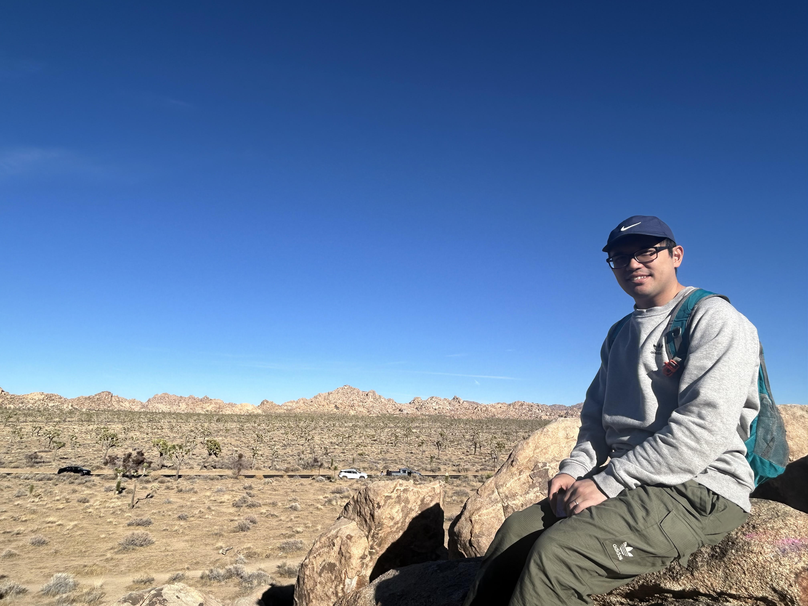

::: {.hero}
::: {.hero-copy}
::: {.eyebrow}
Postdoctoral Research Scholar, Arizona State University
:::

# Hsiao-Ping Ni

::: {.lead}
Telemetry-driven lifecycle intelligence for dependable semiconductor systems, digital twins, explainable AI, and hardware/software co-design.
:::

I build deployable, explainable, and low-overhead AI frameworks that use chip-, host-, and facility-level telemetry to improve reliability, energy efficiency, security monitoring, and operational resilience in semiconductor systems.

::: {.hero-actions}
[Research](research.qmd){.btn .btn-primary}
[Publications](publications.qmd){.btn .btn-outline-primary}
[CV](cv.qmd){.btn .btn-outline-secondary}
[Download CV](assets/cv/Hsiao-Ping_Ni_CV_Postdoctoral_Research_Scholar.docx){.btn .btn-outline-secondary}
:::
:::

::: {.hero-visual}
{.hero-photo fig-alt="Portrait of Hsiao-Ping Ni"}

::: {.hero-figure}
{fig-alt="Silicon lifecycle management research diagram"}
:::
:::
:::

::: {.content-block}
## Research Profile

::: {.signal-strip}
::: {.signal}
**&lt;0.005%**  
EXACT CPU die-area overhead
:::
::: {.signal}
**3.4 pJ/sample**  
edge causal telemetry scoring
:::
::: {.signal}
**95%**  
DICE rich-telemetry detection
:::
::: {.signal}
**3,000**  
A100 GPU-hours grant
:::
:::

## Research Themes

::: {.feature-grid}
::: {.feature}
### Silicon Lifecycle Management

Runtime telemetry, in-field monitoring, anomaly detection, diagnosis, and guarded response for deployed chips and computing systems.
:::

::: {.feature}
### Operational Digital Twins

Behavioral micro-twins, tiered observability, split-conformal calibration, and host-side monitoring under limited signal access.
:::

::: {.feature}
### Explainable Edge Assurance

Fixed-point anomaly scoring, feature-budgeted telemetry analytics, area/power-aware deployment, and near-device decision support.
:::

::: {.feature}
### Networked System Resilience

Causal graph learning, uncertainty-aware diagnosis, signal-level attribution, and engineer-trustworthy evidence for lifecycle decisions.
:::
:::

## Current Direction

My long-term proposed endeavor is to advance scalable telemetry-driven Silicon Lifecycle Management and semiconductor facility intelligence through causal/explainable AI, digital twins, fixed-point edge analytics, and guardrailed decision support for dependable and energy-efficient operations.

My current work develops AI-enabled Silicon Lifecycle Management frameworks that connect:

- **Measure**: quantify how far deployed systems depart from expected operating targets.
- **Explain**: construct drift-robust evidence, causal attribution, and calibrated uncertainty from networked telemetry.
- **Act**: support guardrailed recommendations, escalation, rollback, and lifecycle updates under deployment constraints.

This direction connects digital twins, anomaly detection, explainable AI, causal telemetry learning, and hardware/software co-design into a practical framework for dependable semiconductor systems.
:::
