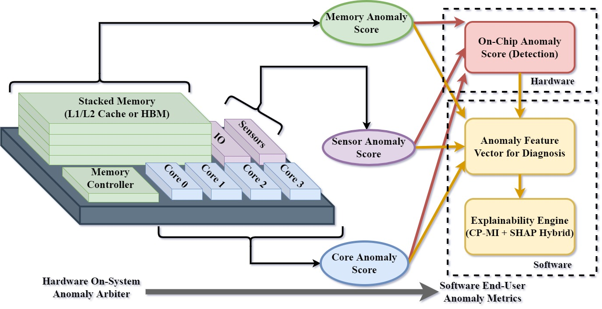

::: {.project-grid}
::: {.project-card}
{fig-alt="DICE project figure"}

### DICE

Digital Twin-Driven In-Field Continuous-Test Engine for Silicon Lifecycle Management. DICE connects runtime telemetry, operational context, and digital-twin reasoning for in-field test and lifecycle assurance.
:::

::: {.project-card}
{fig-alt="EXACT project architecture"}

### EXACT

Edge-eXplainable Autonomous Causal Telemetry for Silicon Lifecycle Management. EXACT targets explainable, causal, and deployment-aware telemetry analytics for dependable systems.
:::

::: {.project-card}
{fig-alt="X-OCTANE project figure"}

### X-OCTANE

eXplainable On-Chip Telemetry-based Anomaly Notification Engine for Silicon Lifecycle Management, focused on practical anomaly notification and explainability from chip telemetry.
:::

::: {.project-card}
{fig-alt="TRACK project figure"}

### TRACK

Telemetry-based Representation Analysis via Centered Kernel Alignment for Silicon Lifecycle Management, focused on comparing telemetry representations and tracking signal structure.
:::
:::

## Semiconductor Facility Intelligence

Before my current postdoctoral focus on chip and system lifecycle assurance, my doctoral work studied AI-driven optimization for semiconductor manufacturing facilities. This includes HVAC/MEP optimization, energy efficiency modeling, indoor air quality, reliability, supply-chain resilience, and circularity for high-reliability fab environments.
