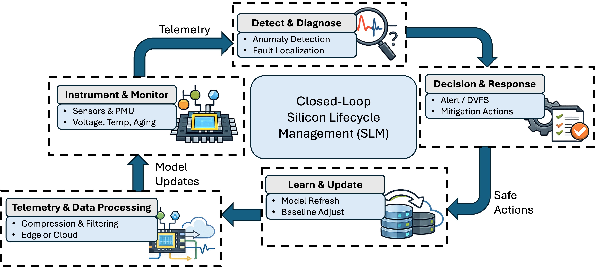
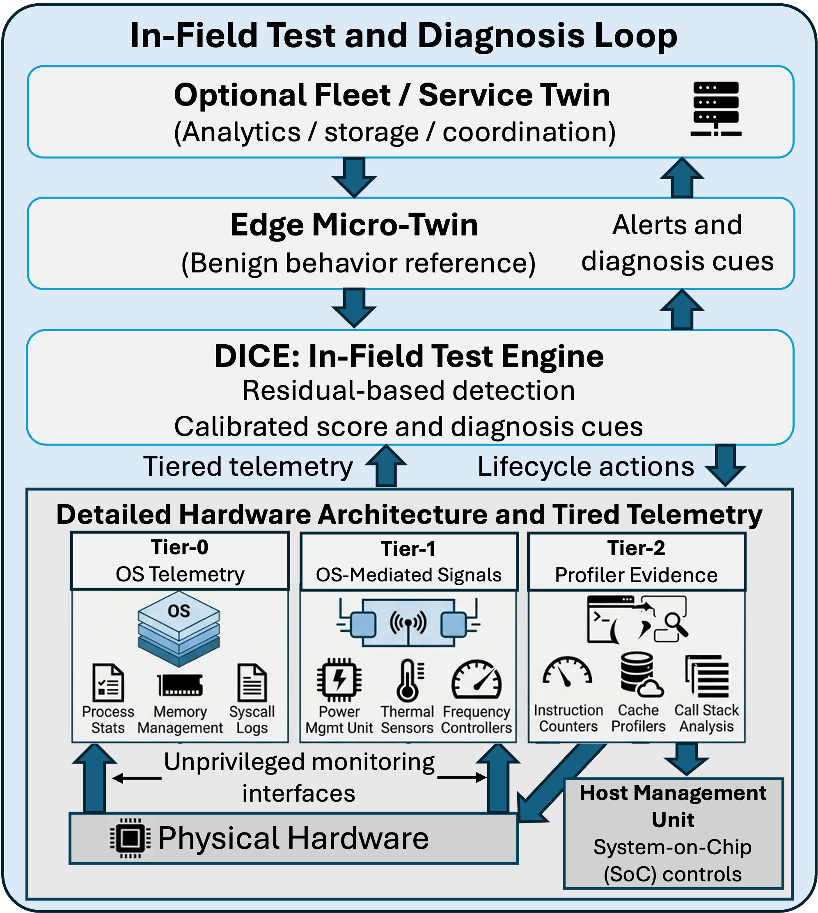
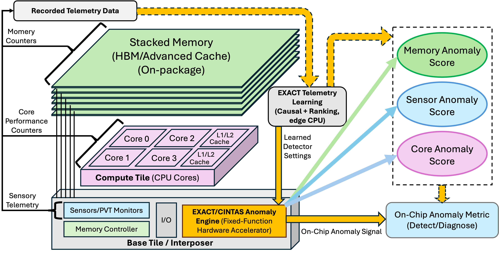
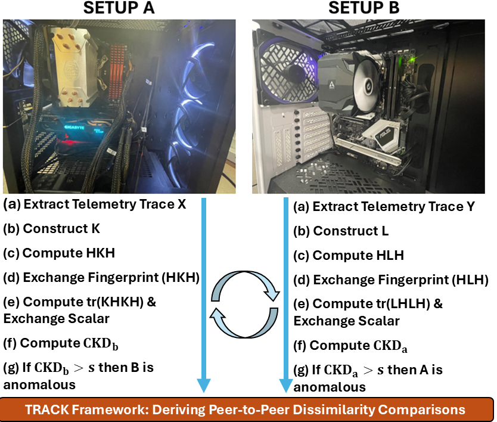
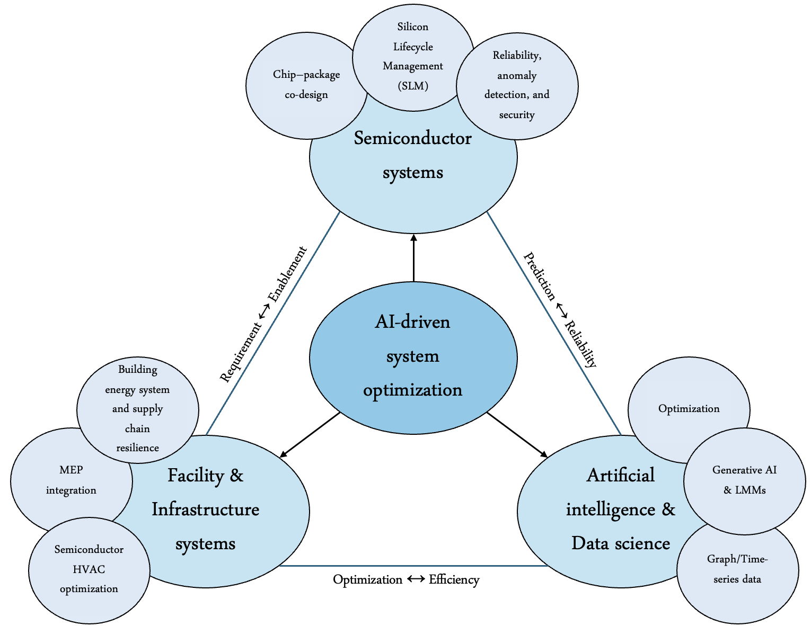
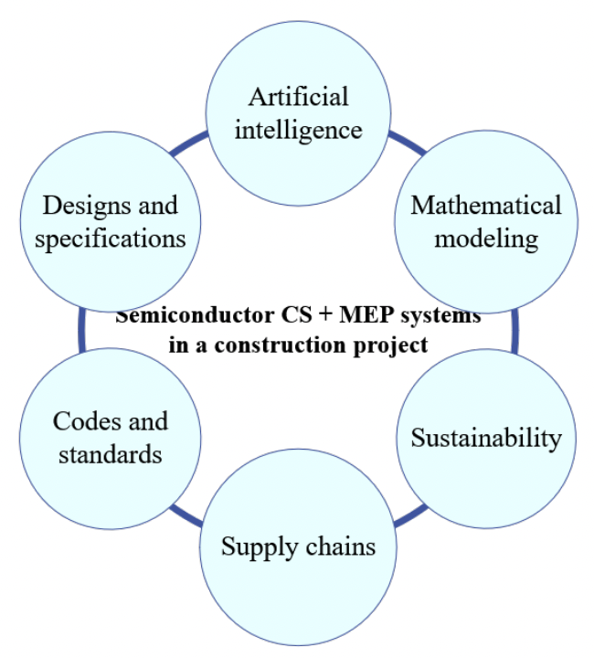

My research develops trustworthy AI methods for semiconductor lifecycle intelligence. The throughline is practical: turn noisy, partial, and drifting runtime telemetry into evidence that engineers can use for monitoring, diagnosis, and safe response.

::: {.note}
Long-term proposed endeavor: advance scalable telemetry-driven Silicon Lifecycle Management and semiconductor facility intelligence through causal/explainable AI, digital twins, fixed-point edge analytics, and guardrailed decision support.
:::

## Research Topics

::: {.feature-grid}
::: {.feature}
{fig-alt="SLM research topic image"}

### Lifecycle Gap Intelligence

Methods for quantifying the gap between expected and observed system behavior across deployment time, workload changes, software updates, and aging effects.
:::

::: {.feature}
{fig-alt="DICE digital twin image"}

### Operational Digital Twins

Runtime digital twins and lightweight monitoring logic that connect telemetry, workload context, and lifecycle state for deployed systems.
:::

::: {.feature}
{fig-alt="Explainable edge assurance architecture"}

### Explainable Edge Assurance

Feature-budgeted anomaly scoring and causal evidence generation that can move toward edge or on-chip implementation.
:::

::: {.feature}
{fig-alt="TRACK networked telemetry representation image"}

### Networked System Resilience

Representation learning and graph-aware analysis for telemetry streams where signals interact across subsystems rather than fail independently.
:::
:::

## Measure-Explain-Act SLM

My current research explores scalable, telemetry-driven SLM frameworks that connect:

- **Measure**: quantify how far deployed systems depart from expected operating targets.
- **Explain**: construct drift-robust evidence, causal attribution, and calibrated uncertainty from networked telemetry.
- **Act**: support guardrailed recommendations, safe escalation, rollback, and lifecycle updates under deployment constraints.

This direction connects digital twins, anomaly detection, explainable AI, causal telemetry learning, and hardware/software co-design into a practical framework for dependable semiconductor systems.

## Research Knowledge Map

{fig-alt="Research knowledge map connecting semiconductor lifecycle management, telemetry analytics, digital twins, and semiconductor facility intelligence"}

## SENTINEL Direction

**SENTINEL: Scalable End-to-End Networked Telemetry for In-Field Operational Efficiency and Silicon Lifecycle Management** is a proposed research direction focused on target-referenced gap metrics, networked telemetry dependencies, calibrated evidence construction, and guardrailed decision policies for safe, drift-aware lifecycle operations.

This direction pushes beyond detect-and-notify monitoring toward systems that can quantify lifecycle gaps, explain their likely causes, and support auditable operational actions.

## Research Experience

### Postdoctoral Research

My postdoctoral research focuses on AI-enabled lifecycle intelligence for semiconductor systems. I work on Silicon Lifecycle Management, telemetry-driven digital twins, explainable anomaly detection, causal diagnosis, uncertainty-aware decision support, and hardware/software co-design for edge and on-chip deployment.

This work extends my systems engineering background from fab-scale infrastructure optimization to chip- and system-scale lifecycle assurance. It has led to publications and submissions in semiconductor design, test, and reliability venues, including IEEE Transactions on Computer-Aided Design of Integrated Circuits and Systems, IEEE European Test Symposium, IEEE International Test Conference, ACM Transactions, IEEE Design & Test, and IEEE VLSI Test Symposium.

Selected current outputs include X-OCTANE, EXACT, DICE, TRACK, and CITADEL. These projects emphasize compact telemetry features, fixed-point scoring, causal evidence, and practical deployment constraints such as area, power, observability, and drift.

### Doctoral Research

My doctoral research focused on AI-driven system optimization for semiconductor manufacturing facilities. I studied mechanical, electrical, and plumbing systems in high-reliability fab environments, with applications in predictive modeling, energy efficiency, indoor air quality, and supply-chain resilience.

Dissertation: **System Optimization of HVAC Systems in Semiconductor Manufacturing Facilities**. Online copy: <https://keep.lib.asu.edu/items/201247>

{fig-alt="Civil, structural, mechanical, electrical, and plumbing systems in semiconductor construction projects"}
